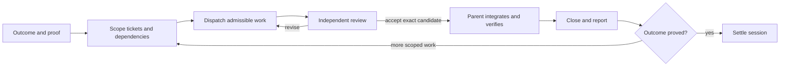

# Proposal 19: orchestrate toward an outcome

**Status:** core delivery completed, 2026-11-04: #202–207 and #179 with its admitted children are done. The [bounded messaging outcome](../research/session-messaging-outcome-20261104.md) records native support and evidence limits. Nine broader follow-ups remain in the [next-session queue](../../plan.md#orchestration-follow-up-queue-reconciled-2026-11-04), selected together with delivered work by `epic:outcome-orchestration`; #201 stays deferred. The original approved design below is historical: its descriptions of then-current gaps are not new outstanding implementation. Completion does not remove security holds or change model defaults.

**Recommendation:** evolve the existing `orchestrate` skill into an outcome-driven session entry point, callable by the user and by an agent acting within existing authorization. Keep one conductor, the current role briefs, and tkt as the work ledger. Add an explicit outcome contract, recovery protocol and evidence-bound acceptance. Do not build another orchestration framework first.

## What the workstream taught us

The useful capability is not simply starting several workers. It is keeping a defined outcome moving through questions, reviews, integration and interruptions without needing repeated “proceed” messages, while making incomplete evidence visible.

| Finding | Evidence and short supporting excerpt | Consequence |
|---|---|---|
| The basic conductor already exists. High confidence, source inspected. | [Current skill](../../../skills/engineering/orchestrate/SKILL.md): “Own admission, decisions, review, landing and reporting”. [Live dry runs](../research/orchestrate-skill-dry-runs-20261101.md) verified registered worktrees and serial landing in bounded fixtures. | Extend this skill and its briefs; retain the qualified harness-specific fallbacks. |
| A runtime workflow does not supply our acceptance controls. High confidence in recorded trial. | [Kiro workflow trial](../research/kiro-workflows-20261102.md): “does not itself create a worker worktree or enforce review independence”. [Plan](../../plan.md) records a fabricated task and missing independent Mate acceptance in the restart trial. | The parent owns requirements, isolation and acceptance; a runtime step called “review” is not proof of an independent review. |
| A completed response is different from usable evidence. High confidence in recorded trial. | [Effort results](../research/model-effort-t171-results.md): “one received a valid independent pass and ten are unscorable”. [Research audit](../research/model-tier-research-20261103-audit.md) records missing independent dispatch/completion traces. | Bind the reviewer identity, reviewed source and actual evidence; invalid evidence remains unscorable. Do not turn it into either a quality pass or a quality failure. |
| Requested models and settings do not prove actual execution identity. High confidence, bounded trials. | [Effort results](../research/model-effort-t171-results.md): “Actual effort was not reported for any completed call”. [Current model guidance](../harness-surfaces/models-and-usage.md) retains defaults and records identity/quality limits. | Assign roles by task and risk; record requested and observed identity separately. Do not prescribe a cheaper worker or higher effort from these small trials. |
| Mutable setup can invalidate a comparison before the model starts. Repaired, not new missing work. | [Seed-freeze ticket](../../../.tickets/200-freeze-complete-evaluation-seed.md): “without invoking live tkt or the mutable general fixture generator”. | Reuse the landed frozen-seed mechanism for comparable experiments; do not rebuild it or repeat the completed model trials. |
| Reviewed UI can become stale during final bookkeeping. Observed and corrected. | [Publication record](../research/orchestration-dashboard.md#accepted-kiro-limitation-and-deferred-repair-2026-11-03): “moving the deferred follow-up into its proper plan queue row changed the embedded queue order”. Fresh captures and renewed acceptance followed. | Finish rendering inputs before freezing review; check receipt currency immediately before publication. Existing receipt tooling already provides the hash check. |
| Task success and process cleanup are separate outcomes. Known limitation accepted. | [Kiro procedure](../../../skills/engineering/orchestrate/references/harness-kiro.md#v3-acp-shutdown-workaround): “Record teardown separately”. [Closure audit](../research/kiro-acp-workflow-closure-20261103-audit.md) accepts workflow handling, not a native fix. | Keep verified task work; classify the exact shutdown signature separately, avoid duplicate retries, observe owned descendants and preserve sessions. #201 remains deferred. |
| Session supervision needs its own verified lifecycle. Conversation-sourced history, not independently reproducible from this proposal. | The supplied conversation includes repeated requests to continue after batches and restore check-ins; privately retained notes describe correction of an active-monitor claim after an error response. Those historical details are attributed session observations, not independently re-fetchable evidence here. The cited [publication record](../research/orchestration-dashboard.md#accepted-kiro-limitation-and-deferred-repair-2026-11-03) supports only the current “no background monitor is scheduled” status. | Ending a batch is not completing the outcome. Record monitor state only after successful native confirmation; missing or possibly user-deleted jobs must not be silently recreated. |

These are not evidence of a production-ready autonomous orchestrator. The trials establish bounded capabilities and failure modes, not general reliability or cost savings.

## The proposed skill

Keep the name **`orchestrate`**. Users can start with `/orchestrate` on a harness that exposes skill slash commands, or `$orchestrate` where that is the supported invocation. The name avoids colliding with a host's built-in `/goal`.

Example request:

> Orchestrate the settings migration until existing projects load unchanged and the new format passes the compatibility suite. Use separate worktrees for independent changes, independent critics, and parent-owned integration. Keep going through the scoped queue; park unrelated discoveries.

An agent may select this skill when the user has already authorized outcome-directed orchestration. Discoverability and skill invocation do not themselves authorize delegation, spend, publication, settings changes or a broader outcome. If orchestration is not authorized, the agent can propose it while continuing work already in scope.

### Invocation policy

The current skill is explicitly user-only: `disable-model-invocation: true` and Codex `policy.allow_implicit_invocation: false`. For the requested user-and-agent behavior, remove both restrictions together, preserve UI metadata, update the engineering index and run the existing invocation-policy check. Default invocation in Claude supports both user and agent entry; its docs say “both you and Claude can invoke any skill”. [Official Claude skill documentation](https://code.claude.com/docs/en/skills).

Proposed frontmatter, **not installed by this review**:

```yaml
---
name: orchestrate
description: Coordinate an authorized outcome through scoped tickets, isolated workers, independent review and parent-owned integration. Use when asked to orchestrate a workstream or continue an agreed orchestrated session.
---
```

Do not solve composition by copying the bodies of restricted skills or bypassing a refused invocation. [Current invocation conventions](../skill-frontmatter.md#invocation-control-is-per-harness-not-one-portable-field) and [the checker](../../../scripts/check-invocation-policy.mjs) address this: the checker validates paired settings/indexes and catches a narrow literal Skill-tool call pattern, not every reference, prompt or runtime call. Review the actual composition paths and scenario-test unauthorized implicit selection separately. Keep `implement` and `implement-spec` user-only unless their invocation policies are separately changed. `orchestrate` can execute its own existing worker contract; a whole-spec integration mode should first extract shared, model-invokable role procedures rather than implicitly calling a restricted entry point.

### Start from one outcome contract

Use the existing spec or a short section in `docs/plan.md` as the durable contract. Do not introduce another task board or mirror all ticket states there. Record these fields once and reference them:

| Field | What it establishes |
|---|---|
| Outcome and proof | What the user can do when complete, and which observations establish it. |
| Scope | Included ticket IDs/spec, excluded work, and how newly discovered prerequisites enter scope. |
| Authority | Existing user decisions; permitted landing/publication route; restricted operations and provider policy. |
| Resources | Concurrent slots including reviewers, shared/exclusive devices or measurement lanes, and any explicitly supplied budget. |
| Completion and stops | Required integration, verification, reporting and cleanup; user pause/cancellation; budget/usage limits and genuine decisions the agent cannot resolve. |
| Revision | The latest user clarification and which assumptions, tickets or experiments it supersedes. |

Infer routine choices from the request and repository. Ask only for missing facts that change the outcome or authorization. Do not invent a token or spending budget. Distinguish a model preference from a paid service tier before preparing experiments; #172's cancellation is an example of a scope correction, not successful delivery.

Native goals may keep the host session running. Codex documents that goal text supplies “the first prompt and the completion criteria”; Claude documents continued work across turns until the condition is met or the goal otherwise clears. [Official OpenAI goal guidance](https://learn.chatgpt.com/docs/long-running-work), [official Claude commands](https://code.claude.com/docs/en/commands).

The skill provides coordination instructions; it cannot create portable runtime persistence, guaranteed delivery or a scheduler. Bind an existing native goal when exposed, or set one only when explicitly requested and supported. Without that support, retain a resumable checkpoint and report the limitation. A scheduled check-in is separately authorized infrastructure, not proof that the parent is running. A goal does not widen permissions; OpenAI explicitly says it “doesn’t grant ChatGPT broader access”.

### The session loop



1. Recover the current contract, ticket state and only this session's dispatch bindings. Reconcile discrepancies with live tools before acting. A temporary resume pointer holds worker IDs, worktree/base/candidate identities, open questions and next actions; it is not authoritative task status.
2. Admit only scoped, unclaimed frontier work with verifiable acceptance and disjoint writes. A missing prerequisite becomes an explicit proposed dependency. Prefer sequential work when there is one useful task or isolation is unavailable. File independence does not establish safe concurrency for timing, usage measurements, shared devices or mutable accounts.
3. Verify checkout identity, base and permissions before edits. Record dispatch before launch; confirm the returned worker/session ID before seeding. Reserve reviewer capacity. With four total slots, parent plus two workers leaves one critic slot; do not recursively spawn two sub-reviewers into a full pool.
4. Await actual events; record questions and completion notices. Parent resolves ordinary choices using the contract and current sources. Pause only the affected operation for missing authority or facts; continue independent scoped work.
5. On completion, check the actual candidate, diff, command output and evidence before review. Review must bind the final candidate and evidence; later code or rendering-input changes invalidate the affected acceptance.
6. Parent integrates serially, verifies the integrated result, pushes using the authorized route, closes tickets with evidence, refreshes the dashboard and publishes only where authorized. An empty frontier means either complete, dependency-blocked or intentionally deferred; inspect which before stopping.
7. Continue after every batch until the outcome's completion condition holds or no authorized progress remains. If tools, dependencies or required facts prevent all further authorized work, report **incomplete/blocked** with the exact condition, retain checkpoint/evidence and name the next event that permits resumption. Do not mark the outcome achieved merely because no ticket is currently on the frontier. Keep already-authorized supervision through reviews/integration, not just worker execution. When a monitor is missing, investigate and report accurately; preserve possible user removal.
8. Settle with delivered capability, accepted limitations, unfinished/deferred work and evidence limits. Stop owned monitors only after their entire authorized purpose is settled, the user stops them, or they are obsolete. Preserve retained evidence and private history under their recorded lifecycle.

At a usage limit, apply the project's [binding provider policy](../../../AGENTS.md#when-blocked): stop, checkpoint and report the limit and reset; never switch providers unless validated policy explicitly permits that operation. This repository's fallback is off. Do not automatically retry while exhausted, infer a reset or raise limits. A native goal or scheduled wakeup does not override that stop. An explicitly supplied budget is also a stop boundary, not permission to spend more.

## Role guidance

Roles are responsibilities, not mandatory separate agents or model families. Parent may perform small sequential implementation; consequential acceptance still needs independence when required by project/user policy.

| Role | Owns | Required report | Boundary |
|---|---|---|---|
| Orchestrator / parent | Contract, admission, resources, questions, review assignment, integration and final user communication. | Current outcome, proved checkpoint, next action and exact blocker when relevant. | Never accept its own summary as independent evidence; do not stop because one dispatch pair ended. |
| Implementation worker | Assigned slice in a verified worktree, assumptions, scoped edits and appropriate tests. | Actual root/branch/base/candidate, changed files, check commands/results and remaining unknowns. | No main-checkout writes, self-expanded permissions, substitute claims or parent-owned close/merge. |
| Research or spike worker | One question or hypothesis, primary sources, bounded experiment and retained evidence. | Supported findings, contradictory observations, couldn't-verify section, artifact index and recommendation. | No unrequested installation, global changes, model calls or repeated unchanged experiments. |
| Independent critic | Acceptance expectations written before examining the candidate; evidence and material-risk review. | PASS/BLOCK for the exact candidate, concrete trigger/outcome findings, missing provenance and coverage limits. | No source repairs or ticket mutation during read-only review. Parent files follow-ups. A second generated answer is not proof of another reviewer. |
| Integration owner | Serial merge/rebase resolution, fresh integrated gates and authorized push. Usually the parent. | Integrated SHA, scope diff and classified check outcomes. | Worker-branch success does not prove integrated correctness. A textual merge is not acceptance. |
| Supervisor / scheduled check-in | Only the named session's leases, stale check-ins, pending reviews and recovery signals. | Quiet on unchanged/non-actionable state; notify completion, failure or necessary intervention. | It does not accept code, broaden the queue or recreate a possibly user-removed job. |

Continue using the existing [worker](../../../skills/engineering/orchestrate/references/worker-brief.md), [reviewer](../../../skills/engineering/orchestrate/references/reviewer-brief.md) and [escalation](../../../skills/engineering/orchestrate/references/escalation.md) references. Add only the missing contract and recovery fields. A critic reviewing a small document need not launch a full nested code-review tree.

### Keep result dimensions separate

The existing terminal status protocol remains useful for messages. Do not overload `DONE <sha>` to mean accepted, integrated, deployed and cleaned up simultaneously. The parent should track these observations separately in its binding/evidence record:

- Work: proposed, running, candidate ready, accepted, integrated, delivered, or intentionally stopped.
- Verification: pass, assertion failure, skip, infrastructure error, timeout, survivor, or unavailable coverage. An unscorable research review is not a code test failure.
- Cleanup: observed settled, unresolved, or unobserved; preserve owned identities and recovery state.
- Delivery: local, pushed, published, or publication failed; use actual native results.

Use a small tagged representation if tooling is built; avoid a collection of booleans that permits impossible combinations. These are proposed observations, not new tkt statuses. A retry needs a changed cause/hypothesis or an authorized retry policy; it is not an automatic response to an infrastructure exit.

## Other project improvements, in proposed order

These are recommendations, not newly authorized implementation. Existing tickets retain ownership; do not file duplicates or revive closed experiments.

| Priority | Proposed change | Existing ownership / evidence | Acceptance that would make it useful |
|---|---|---|---|
| First | Add the outcome contract, continuation/stop rules and explicit role/resource allocation to `orchestrate`. Enable user-and-agent invocation consistently. | Extend shipped #111; [proposal 17](17-orchestrator-skill.md) is historical design, not another unbuilt skill. | Scenario tests distinguish batch completion from goal completion, blocked frontier from success, and a clarified scope from the old plan. One bounded live run later proves the workflow, with current authorization. |
| First | Make dispatch identity and candidate review binding mechanically checkable. Use absolute input/output roots plus actual Git worktree/base evidence before writes. | [#145](../../../.tickets/145-concurrent-session-checkout-guard.md) owns concurrent-checkout detection; [#148](../../../.tickets/148-worktree-takeover.md) owns safe takeover; [#141](../../../.tickets/141-code-review-staged-fixed-point.md) owns staged review targets. | Cheap on-demand validator rejects wrong checkout, stale base/candidate, missing owner and stale receipt; it must not claim to prove semantic non-overlap or reviewer independence from a name string. |
| First | Reuse a durable message/session interface for cross-harness recovery rather than another ad hoc supervisor. | [#179](../../../.tickets/179-inter-harness-session-communications.md), high priority, already owns this in `stream:tooling`. It is outside the completed spike queue; Agy execution remains held. | Distinguish queued/received/completed, suppress duplicate delivery, bind session generation and report unsupported lanes. Skill-only orchestration need not wait for every adapter. |
| Next | Finish all rendering inputs, then capture/review once; run a current receipt check immediately before publication. | Existing [receipt implementation](../../../skills/productivity/delivery-dashboard/scripts/review-receipt.mjs) already catches drift. Extend use, not a replacement hash system. [#118](../../../.tickets/118-dashboard-execution-workflow.md) and [#139](../../../.tickets/139-dashboard-contract-custom-pages.md) own related dashboard behavior. | Publication preflight rejects stale accepted receipts, mismatched packaged source and hidden remaining/deferred tickets. Keep known schema checks separate from actual browser interaction evidence. |
| Next | Repair stale operational references with explicit version/scope ownership. | [#166](../../../.tickets/166-refresh-harnesses-md-versions.md) owns the harness overview. [Skill frontmatter](../skill-frontmatter.md) still says a plugin manifest must enumerate every nested skill; the [actual manifest](../../../.claude-plugin/plugin.json) lists bucket directories and [distribution maintenance](../distribution-maintenance.md) documents that current choice. | Align the discovery description with current distribution; qualify lifecycle guidance by done vs cancelled status and verified CLI behavior. Mark proposal 17 as historical/implemented without treating all old unchecked design boxes as current work. |
| Next | Reduce irreversible action chaining and manual bookkeeping. Checks, acceptance, commit and push should be separate dependent operations with explicit failure handling. | [PowerShell guidance](../windows-powershell-gotchas.md) already says a semicolon continues after failure. Current review needed renewal before publication; the protection worked, but the operator path was laborious. | Reuse gate exit/results and receipt checks; if a publication wrapper is justified by recurrence, test a rejected receipt and failed check cannot reach push/publish. Do not add a global hook or broad gate for prose-only mistakes. |
| Later | Reconcile plan, priorities and evidence retention without expanding the active outcome. | [#149](../../../.tickets/149-reconcile-priority-review.md) owns priority review; [#201](../../../.tickets/201-kiro-acp-shutdown-followup.md) owns deferred shutdown research. #06 and #09 remain separately parked. | Explicit queue order vs dependencies, clear scope revisions, and artifact owner/purpose/end condition survive handoff. Current monitor state comes from native confirmation, not old prose. |
| Later | Evaluate the coordinator itself, not only model task answers. | Extend the existing [orchestration fixture](../../../scripts/spike-orchestrate-fixture.mjs); #199/#200 already repaired frozen evaluation setup. #06 is the wider model/skill-drift evaluation backlog, not an excuse to repeat #167–171. | Inject wrong-root, stale-SHA, lost completion, contradictory verdict, cancelled scope, full reviewer pool, missing monitor, timeout and failed publication cases. Measure autonomous continuation, false acceptance and recovery, with observed identity/cost limits. |

Judgment belongs in role guidance: outcome clarity, overlap, risk, source relevance and whether a clarification changes the work. Mechanical invariants belong in small reusable checks: root/base identity, required packet fields, exact hash binding, receipt currency and command exit handling. New checks should run on demand first; stage admission still follows [local gates](../local-gates.md), measured scope and budget. Do not add every new check to pre-push.

Do not solve host-contention timeouts by generalizing the previous two-check exception. The [recorded baseline comparison](../research/evidence/orchestration-gate-baseline-20261103.json) applies to exact runs and inputs. Existing gate timing/optimization repairs (#137, #177) are done; fresh timing problems need fresh attribution. Likewise, make TDD conditional on building behavior and useful regression evidence; a research report or reversible wording change does not warrant implementation-mirroring tests merely because `implement` currently names TDD unconditionally.

## Suggested implementation sequence

1. Agree this contract and evolve `orchestrate`/briefs/index policy as one scoped change. Keep the entry point short; disclose harness and recovery detail through references.
2. Apply the dispatch identity and review-binding additions through existing work where it overlaps. Add only missing deterministic helpers and scenario fixtures.
3. Implement #179's shared messaging/recovery interface in supported lanes; preserve explicit unsupported/security-held lanes.
4. Add publication preflight around the already-shipped receipt checker and reduce duplicate dashboard preparation.
5. Correct operational reference drift, then run a bounded goal-directed dry run with independent review. Keep deferred research deferred.

The first usable version should coordinate the supported local harness and one observable outcome. It does not need a generic ACP platform, nested conductors, new account entitlements, changed global harness settings or a claim of exactly-once delivery.

## Review coverage and limits

This is a sampled cross-cutting review of the orchestration workstream and the related project workflows, not an audit of every skill or every raw response. Two fresh-context agents independently examined the coordination history and project architecture. Coverage included current `orchestrate`/role briefs, proposal 17, `implement`/`implement-spec`, planning/bookend/invocation guidance, gate selection and receipt source, current plan/ticket overlap, bounded private coordination history, and focused findings/audits from the workflow, model, seed-freeze and shutdown trials. Large/truncated search output was followed by focused reads for load-bearing claims; untouched results are not claimed as reviewed. Some reports were sampled at their result/audit sections rather than every raw evidence file.

The installed `tkt 0.4.0 (898ceb5)` and `tkt reopen --help` were read on 2026-11-03; the latter explicitly describes returning a **cancelled** ticket to open. No conclusion about reopening done tickets follows from that help. Current official OpenAI and Claude goal/skill pages were opened the same day; those are rolling documentation, not live qualification of every installed client. Native goal persistence, new session adapters and the proposed skill changes were not exercised. No model calls, native worker probes, installs, settings changes, ticket mutations or monitor creation were part of this review.
