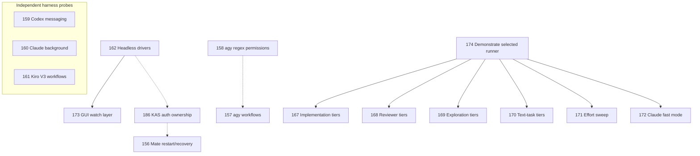

# Current work plan

The coordinated [release plan](agents/proposals/09-release-readiness.md) and
[release contract](agents/release-contract.md) define scope and acceptance.
User-approved staging versions: grey-matter 0.2.0 and tkt 0.5.0. Publication is
not authorized. Candidate preparation, install/upgrade verification, final audit and
artifact staging are complete. Native Linux and Windows validation are verified.

## Active release thread

| ID | Work | Status |
| --- | --- | --- |
| 68 | Publish and resume coordinated GitHub and plugin releases safely | ✅ done |
| 67 | Prepare version-consistent release candidates and plugin bundles | ✅ done |
| 69 | Verify plugin fresh installs and upgrades in isolated harness homes | ✅ done |
| 77 | Validate native release candidates on Windows (SharkTank) | ✅ done |
| 78 | Validate native release candidates on Linux (randomserver) | ✅ done |
| 70 | Audit both projects before release staging | ✅ done |
| 71 | Stage reviewed changelogs README files and release artifacts | ✅ done |

Tickets 67–69 are complete, including the independent integrated publication review,
prepared Cargo evidence, sole CI publisher/dispatcher, candidate preparation and
isolated fresh-install/upgrade checks. Audit-discovered resource closure ticket 76 is
also complete; the restored evidence file is verified in all three grey-matter bundles.

Current frozen candidates are grey-matter
`e071b7b03d02025dc1af6c3ff2c4f8369f777587` and tkt
`2b6ff173993c9fe413c40287fb1cb3f0a9879ca1`. Product/native checks, all six harness
probe groups, Windows/Linux product gates and tkt's five-target build-only stage pass.
The [final audit](agents/research/final-release-audit-20261024.md) records evidence,
ticket dispositions and the completed native platform evidence. Linux ticket 78 is complete after SSH validation on randomserver. [Windows ticket 77](agents/research/windows-native-validation-completion-20261024.md) is complete after authorized live duplicate cleanup and a passing complete Codex candidate catalog/state probe, with no scope exclusion.

Audit 70 and staging 71 are complete. The [staging closeout](agents/research/release-staging-20261024.md) pins review commit
`c24720f77f252544659a376a1493fd5c53985018` and the dedicated review branch.
No further release execution is authorized. Keep staging tied to these frozen candidates;
source behavior or release-documentation changes require replacement artifacts and
affected evidence. This live plan and ticket receipts record later progress; embedded
plans in frozen bundles remain snapshots of their source revisions.

On 2026-10-28 the user chose to prepare grey-matter 0.2.0 again from current main
rather than publish `e071b7b`, which main had passed by 91 commits (it lacks
`data-modeling`, `delivery-dashboard` and later work). The frozen candidate and review
branch stay as the worked example; the new candidate needs its own evidence and staging.
Current candidates: grey-matter `05792a71c7e936b3ed26a623933bbfa224d7b93c` (from main
`a4db04a`, pushed branch `codex/release-grey-matter-0.2.0-a4db04a9`) and tkt
`a827bb6f264ad2ef73157fd8c0a471cb78e634fe` (from tkt main `c4d2ad5`, pushed branch
`codex/release-tkt-0.5.0-c4d2ad54`); work output is `~/release-work/20261028/` on
randomserver. The first grey-matter re-candidate `1efb247` failed the Windows product
gate on two artifact-hygiene tests (ticket 99, fixed in `a4db04a`) and is superseded.
grey-matter's deploy engine had changed since tkt `2b6ff17` vendored it, so the user
approved preparing tkt 0.5.0 again, with all open tickets in both repos deferred.

Passing evidence for the current pair:
- Linux (randomserver): product and native gates for both (agy via the pinned 1.4.6
  wrapper); all six harness probe groups, with the 10-24 Linux probes retargeted and
  their expected catalog size raised from 51 to 53 (48 + 4 + 1 foreign).
- Windows (SharkTank, re-keyed 2026-10-29): product and native gates for both, and the
  previous-release-to-Codex upgrade probe (53 skills, foreign preserved). The tkt clone
  uses `core.autocrlf=false`, as on 10-24. Evidence archive
  `windows-evidence-20261029.zip`, sha256 `4f135c6a…db9dbf`.
- macOS (SpaceJam, arm64, macOS 26.6.2, 2026-10-29): product gates (all 16 grey-matter
  groups) and native gates for both under the loopback-only sandbox; all six harness
  probe groups, using the Mac's 10-24 probes with the same retargeting. Installed Kiro
  2.35.1 refuses an unauthenticated session, so the kiro probe ran the notarized
  official Kiro 2.34.0 build that matches the Linux pin (recorded in `kiro-pin.json`).
  Evidence archive `mac-evidence-20261029.zip`, sha256 `faa4e26d…85cc4021`.
- tkt five-target build-only stage, Actions run 40822712451.

- tkt CLI: the CI x86_64 Linux binary reports `tkt 0.5.0 (a827bb6)`; the CLI-surface
  check (386 invocations, 42 files, 21 commands) and tag-context check pass.

Staged 2026-10-29 for review: the [final audit](agents/research/final-release-audit-20261029.md)
is go for staging. The carrier is on `codex/stage-grey-matter-020-tkt-050-20261029` at
review commit `6b983fcda0e3326f96d32a656fa691cc188bacb3`, and its
`docs/agents/releases/20261029/verify.mjs` passes at that commit (both products, no pending
gates, tkt CI provenance re-read). tkt's publication plan passes read-only. Publication
waits for an explicit request; recheck crates.io, artifact retention and the changelog
merge first ([publication commands](https://github.com/smileynet/grey-matter/blob/codex/stage-grey-matter-020-tkt-050-20261029/docs/agents/releases/20261029/publication.md)).

## Next release scope: grey-matter 0.3.0 and tkt 0.6.0

Approved 2026-10-29 from the
[scope review](https://claude.ai/artifact/NbGTVyVy3Qgsw5YpXJqXE5) and the workflow-guidance
review (ticket 101). The versions are proposed; the staged 0.2.0 / 0.5.0 pair publishes
first, and only on the owner's word. Ticket ids are per repo.

| Theme | grey-matter tickets | tkt tickets |
| --- | --- | --- |
| A. Native epics, owners and labels | 04 | 193–200 |
| B. Agents can trust what tkt reports | 98 | 138, 127, 143, 144, 151, 153, 176, 177 |
| C. Safe setup and ticket lifecycle | 82, 85, 88, 97 (artifact cleanup at close) | 190, 163, 164, 165, 145, 202, 66, 159, 227 (cancelled status, ADR 0004), 229 (cleanup in tkt-work) |
| D. A dashboard that checks itself | 90, 92, 109 (already on main: 100) | |
| E. Workflow guidance (ticket 101) | 102, 103, 104, 105, 106, 107, 108 | 177 (evidence limits) |
| Small fixes | 20, 44 | |

Already on main for these versions: grey `bca9a2a` and `734c5ee`, tkt `752b14c` and
`dd559e5`. Land tkt 138 before theme A's fields so they declare themselves in the
manifest, and land grey 82 before 88 (same installer). grey 109 ships with tkt 227.

## Test optimization and verification

Reconciled 2026-11-02 at the user's request. Scope: `stream:test-verification`.
12 unfinished tickets (10 open, 2 in progress) and 11 completed tickets. This stream excludes orchestration and dashboard
feature work; #116 covers only the evidence/current-summary contract. Existing release
authorization and frozen candidate scope are unchanged.

The order below is the session's chosen execution policy, not new dependency edges. All
existing blocked_by values are preserved. Active workers: #115 and #117; next unclaimed ticket: #113. Pursue #122 only when a useful
failure is captured. macOS work needs a Mac; WSL and destructive footprint probes need a
suitable owned environment. No host-only criterion is satisfied by a Windows fixture pass.

On the installed tkt 0.4.0, tag-context queries also include untagged tickets. Exact stream
membership is the 23 rows below; an untagged result does not add a ticket to this plan.
Reconciliation verified all 23 tags, unchanged statuses/dependencies/acceptance checks, and
tag-only edits to the seven closed tickets. The 16 open tickets' validation fields now mirror
their existing acceptance checklists; reconciliation itself establishes no new implementation pass.
Fresh reconciliation checks: pre-merge ticket-graph passed (1 selected check, 0.7 s), documentation
consistency passed for 50 skills, and plan status checking passed with zero findings. Ticket
validation passed with seven pre-existing closed-ticket checkbox warnings. Temporary audit
scripts/snapshot are recycled after their conclusions are recorded here.

| ID | Work | Status |
| --- | --- | --- |
| 104 | 1. Stateful ownership and terminal-behavior contracts | ✅ done |
| 106 | 1. Numbered verification attempts and failure retention | ✅ done |
| 114 | 1. Portable check discovery and fail-stop dependent mutations | ✅ done |
| 112 | 2. UI capabilities and qualified observations | ✅ done |
| 115 | 2. Positive scoped preservation evidence | in_progress |
| 117 | 2. Retrospective coverage and repaired-versus-remaining work | in_progress |
| 113 | 3. Exact bundle inventory and portable byte hashes | open |
| 116 | 4. Current summaries derived from scoped evidence | open |
| 120 | 5. Documented vendor repair and checkout divergence handling | open |
| 98 | 5. CLI/pack compatibility and identity-bound reuse | open |
| 121 | 5. Windows critic launch and unsupported-version diagnostics | open |
| 132 | 6. Windows footprint rows and disposable bin/placeholder probes | open |
| 133 | 7. WSL 2 backing-volume and reclaim validation | open |
| 175 | 8. macOS inspector/lsof hang diagnosis | open |
| 131 | 8. macOS/APFS footprint validation | open |
| 122 | Throughout: diagnose a captured deployer failure; 20-run criterion already met | open |

Completed in this chat, with their original closure evidence preserved:

| ID | Work | Status |
| --- | --- | --- |
| 105 | Check generated tests against the contract and prove the assertion ran | ✅ done |
| 119 | Choose the cheapest faithful test environment with explicit lifecycle gates | ✅ done |
| 137 | Slim the deployer and release-integration checks (92 s and 146 s at pre-release) | ✅ done |
| 152 | Scope project commit gates to vital, changed parts and bound verification scratch | ✅ done |
| 176 | Test fixtures isolate Git from the user's global config (signing, hooks, editor) | ✅ done |
| 177 | gate.mjs --record writes measured timings into gates.json | ✅ done |
| 178 | Warn when grey-matter's own clone has no core.hooksPath, so pushes skip the pre-push stage | ✅ done |

For each remaining ticket: verify premises, implement its scoped change, run applicable checks,
review acceptance, commit/push and deploy guidance changes before closing with evidence.
Finish with integrated pre-release verification plus the named platform checks. Promote or
recycle owned artifacts; leave unresolved external evidence explicit rather than forcing closure.

## Orchestration workstream (reconciled 2026-11-02)

Scope: exactly the 27 tickets in the two tables below, tagged
`stream:orchestration`: 16 open and 11 done, with no in-progress ticket.
Other tooling, test-verification, dashboard and release work remains in its
existing stream. Related parked #06 (skill/version drift evaluations) and #09
(fresh-process versus subagent guidance) remain deferred outside this active
spike set. This reconciliation does not authorize release publication or new
global harness settings.

The remaining-work table is the proposed serial execution order. First finish
#162's retained transport/recovery thread, then resolve #186's current KAS auth
question. #162 and #186 have high priority. Run #158 before #157 to inform its
permission setup; this is a recommendation, not a fabricated blocker. Other
independent probes may proceed in parallel with disjoint private fixtures and
bounded usage; their order below keeps the current harness work together before
the model comparisons.

Hard remaining edges are #162 → #173 and #174 → #167–172. The rest of each
ticket's blocked_by records completed fixture/baseline prerequisites, retained
for provenance. #174 must leave a runnable selected recipe. If both runner
paths fail, create and link the missing execution prerequisite to #167–172
before closing #174; a framework preference alone does not unblock the trials.
#156 can use verified CLI-owned auth independently of #186; Crew-owned relay
auth remains conditional on the result of #186.

| ID | Work | Status |
| --- | --- | --- |
| 162 | 1. Finish headless driver comparison, recovery and retained t111 evidence | open |
| 186 | 2. Verify KAS relay authentication ownership and record a supported recipe | open |
| 156 | 3. Qualify Mate report/wake recovery across gateway restart | open |
| 158 | 4. Test narrower agy regex permissions with negative controls | open |
| 157 | 5. Test agy native workflow dispatch and per-role model selection | open |
| 159 | 6. Test available Codex multi-agent/message-board/wake features | open |
| 160 | 7. Test Claude background sessions and idle notification semantics | open |
| 161 | 8. Test Kiro V3 workflow execution, pause, resume and retry | open |
| 173 | 9. Compare GUI watch/answer surfaces against #162's stable driver | open |
| 174 | 10. Select and demonstrate Harbor or a thin runner for the model trials | open |
| 167 | 11. Compare implementation worker tiers | open |
| 168 | 12. Compare reviewer tiers with planted defects and false positives | open |
| 169 | 13. Compare research/exploration tiers against a fixed answer key | open |
| 170 | 14. Compare documentation, triage and classification tiers | open |
| 171 | 15. Sweep effort levels while holding each model fixed | open |
| 172 | 16. Compare Claude fast mode on/off with measured quality and usage | open |

Solid arrows below are hard dependencies; dotted arrows are proposed order only.
Completed prerequisites are omitted from this graph and remain in the tickets.

Completed baseline and delivered guidance (historical closure evidence preserved):

| ID | Work | Status |
| --- | --- | --- |
| 124 | Shared disposable orchestration fixture | ✅ done |
| 125 | Claude Code baseline | ✅ done |
| 126 | kiro-cli baseline | ✅ done |
| 127 | Codex baseline | ✅ done |
| 128 | Kiro Crew baseline | ✅ done |
| 129 | agy baseline | ✅ done |
| 111 | Authored and exercised orchestrate skill and harness references | ✅ done |
| 95 | Optional Kiro Crew ticket-state mirroring | ✅ done |
| 154 | KAS allowlist denial/escalation qualified; unattended approvals not established | ✅ done |
| 155 | External adapters initialized; ordinary mixed-backend loop remains unverified | ✅ done |
| 185 | KAS architecture and initialize-only protocol research | ✅ done |

Closed tickets received tag-only metadata corrections; statuses, acceptance
checkboxes, dependencies and resolution bodies were preserved. Existing unchecked
historical boxes on #125–129 remain visible warnings, not newly claimed passes.
All 16 open tickets now have concrete validation fields, current context and
explicit prerequisites. #155 is not reopened: a new mixed-backend probe requires
a supported configuration/version or a separately chosen design, not repetition
of the same unsupported split.

Native tkt 0.4.0 context queries also include untagged tickets. Use the exact
27-ticket membership above rather than treating every context-query result as
in scope. The initial scoped frontier is #162, #186, #156–161 and #174;
#173 awaits #162 and #167–172 await #174. Plan order is advisory among frontier
members, while declared dependencies remain authoritative.

Retained private t111 evidence belongs to #162; the prepared 98,400-byte t158
fixture belongs to #158. The managed deployment checkout is retained: the app
refused archival because another active task still uses it. Preserve it until
the app permits normal archival; do not bypass that active-use guard.
No new model run, adapter installation, credential change or fixture cleanup was
performed by this reconciliation.

Reconciliation checks passed: all 27 stream tags and statuses verified, all 11
closed bodies preserved with tag-only changes, three validation fields per open
ticket, exactly one plan row per scoped ticket, and the expected nine-ticket
frontier. `tkt sync-plan --check --brief` passed with zero findings;
`tkt validate --brief` passed with the seven existing closed-checkbox warnings.
Documentation consistency and home-path checks passed. On reconciliation commit
`e81b53e`, pre-merge passed ticket-graph and syntax fixtures (2 selected checks),
and pre-push passed documentation links and home-path (2 selected checks).
Deployment from that clean pinned checkout passed for all 50 skills; the
installed tag-conventions resource matched the source hash. The existing native
plugin generic-icon warning remains. Recycled the 22,915-byte owned temporary
reconciliation scripts/snapshot and 8,702,671-byte generated deployment bundle;
the retained fixtures above are outside this cleanup. Another chat's pending
AGENTS/dashboard files were excluded from this commit and deployment source.

## Open work order (reconciled 2026-10-31)

Order follows the rubric: finish the in-flight threads, earlier ids first, real blockers
override position, priority breaks ties only. Waves run top to bottom; rows within a wave
are in the order to take them. Release themes above still say what ships in 0.3.0.

| ID | Work | Status |
| --- | --- | --- |
| 107 | Wave 2: improve-codebase-architecture names the next real change a seam simplifies | open |
| 108 | Wave 2: writing-for-agents ties pruning to observed navigation failures | open |
| 92 | Wave 3, dashboard checks itself (theme D): fix the gaps the critic model spike found | open |
| 90 | Wave 3: build the dashboard copy and results critics (after 92) | open |
| 109 | Wave 3: delivery-dashboard understands tkt's cancelled status (ships with tkt 227) | open |
| 118 | Wave 4: show a complete visual execution queue with one active ticket in serial mode | open |
| 87 | Owner decision: setup-repo links shadow handoff and grill-me in Kiro | open |
| 89 | Owner approval per repo: adopt the dashboard template in three other repos | open |
| 94 | Low: Kiro hook runs check-repo before an agent push | ✅ done |

## Parked work

These are existing backlog items, not newly approved release scope. Audit 70 records
their release dispositions; this table does not clear any blocker.

| ID | Work | Status |
| --- | --- | --- |
| 04 | Migrate grey-matter conventions to native tkt features once 192-199 land | open |
| 06 | Model-eval harness: track how model changes affect skill handling and leverage | backlog |
| 09 | Spike: shell-invoked fresh agent (kiro-cli/codex/claude) vs subagent for fresh-context tasks | backlog |
| 10 | Make skills tkt-preferred but tracker-adaptable (GitHub Issues, others) by context | backlog |
| 11 | Revisit triage: make GitHub adapter first-class once dependency work lands | backlog |
| 12 | Deep-dive original cited sources (Ousterhout, Tornhill, Feathers, etc.) to sharpen lenses and references | backlog |
| 15 | Add and test wizard sinks for game projects (export_presets.cfg, keystore path) | backlog |
| 16 | Test wizard end-to-end against known and unknown scenarios (post v0.1.0 deploy) | backlog |
| 18 | Test an agent-focused routing skill (adapt the router or create a separate agent-router) | backlog |
| 19 | Live-test teach against existing projects and related works | backlog |
| 20 | Consider trimming pr's inline visual catalog to references/ (depth-bar nit) | open |
| 21 | Review the beta (in-progress) and frozen (misc) upstream skills for adaptation | backlog |
| 23 | Spike: validate the release-process skills (changelog, readme, release) | backlog |
| 24 | Wrap tkt-provided skills (not commands); record the wrap-skills-not-commands rule | backlog |
| 33 | tkt: allow checking ACs on a superseded/closed ticket (or validate --fix to repair unchecked-acs-on-done) | ✅ done |
| 43 | Revisit adopt-project glossary seeding: (b) stage-then-write vs (c) hybrid, from real-use findings | backlog |
| 44 | orient could nudge if the pre-commit hook isn't installed (optional) | open |
| 96 | Docker containment option for Codex critics (only if critics must read files) | backlog |
| 110 | Keep agent footprint bounded while work runs, not only at ticket close (proposal 16) | ✅ done |

## Additional tracked work (reconciled 2026-11-01)

The test-verification chat's scope and current order are recorded in the dedicated section above. Orchestration follow-ups retain their separate chat. This ID-ordered inventory adds missing rows without changing approved release scope; dependencies remain authoritative. See [chat ownership and integration handoff](agents/handoffs/2026-11-01-chat-cleanup.md).

| ID | Work | Status |
| --- | --- | --- |
| 130 | Regress shared user-managed skill duplicates without overwriting local changes | open |
| 139 | Validate the delivery-dashboard contract on custom dashboard pages | open |
| 140 | Ticket commands must not sweep staged work into ticket commits | open |
| 141 | code-review accepts staged or uncommitted work as its fixed point | open |
| 142 | Installed plugin lags the repo so orient routes to skills that are not installed | open |
| 143 | init-project and conformance-audit check cross-harness readiness (Antigravity, Codex) | open |
| 144 | Artifact hygiene rewrites relative links and screens privacy and copyright when promoting scratch | open |
| 145 | Detect another live session in the same checkout and suggest a worktree | open |
| 146 | delivery-dashboard lists only open questions, generated from a structured source | open |
| 147 | to-questionnaire offers an HTML decision form with recommendations and copy-for-chat | open |
| 148 | Take over another agent's worktrees and branches safely | open |
| 149 | reconcile-tickets runs a priority review over workstreams, queue and blockers | open |
| 150 | Add an optional product map (jobs, workflows, feature status) to the delivery dashboard | open |
| 164 | Upgrade path: bring a project up to a new grey-matter release's standards (conformance-audit mode recommended) | open |
| 166 | Refresh harnesses.md to the installed harness versions (first harness-changelog review) | open |
| 179 | Implement inter-harness session messaging and wakeups | open |
| 180 | Review philippines-trip's worktree rules and audit script for adoption | open |
| 181 | Add a scratch-prune recipe to repository-artifact-hygiene | open |
| 182 | Detect footprint growth outside repository scratch | open |
| 183 | Preserve artifact ownership across agent handoffs | open |
| 184 | Revalidate preservation state before cleanup recommendations | open |
