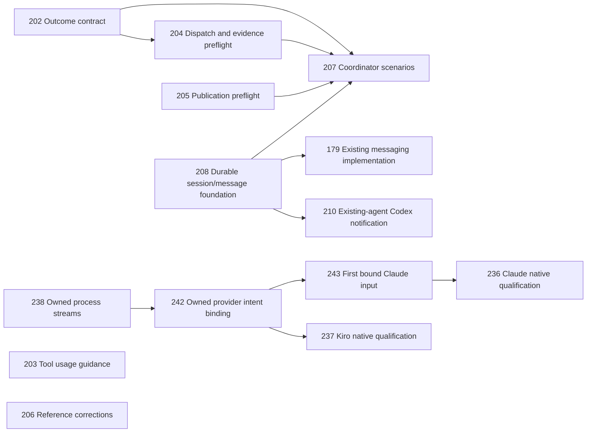
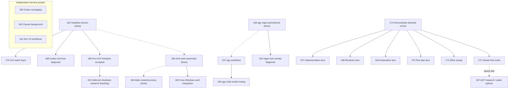

# Current work plan

The [orchestration dashboard](orchestration.html) presents this effort's findings,
evidence limits, dependency flow and expandable ticket log in two tabs.

The coordinated [release plan](agents/proposals/09-release-readiness.md) and
[release contract](agents/release-contract.md) define scope and acceptance.
User-approved staging versions: grey-matter 0.2.0 and tkt 0.5.0. Publication is
not authorized. Candidate preparation, install/upgrade verification, final audit and
artifact staging are complete. Native Linux and Windows validation are verified.

## Active release thread

| ID | Work | Status |
| --- | --- | --- |
| 68 | Publish and resume coordinated GitHub and plugin releases safely | ✅ done |
| 67 | Prepare version-consistent release candidates and plugin bundles | ✅ done |
| 69 | Verify plugin fresh installs and upgrades in isolated harness homes | ✅ done |
| 77 | Validate native release candidates on Windows (SharkTank) | ✅ done |
| 78 | Validate native release candidates on Linux (randomserver) | ✅ done |
| 70 | Audit both projects before release staging | ✅ done |
| 71 | Stage reviewed changelogs README files and release artifacts | ✅ done |

Tickets 67–69 are complete, including the independent integrated publication review,
prepared Cargo evidence, sole CI publisher/dispatcher, candidate preparation and
isolated fresh-install/upgrade checks. Audit-discovered resource closure ticket 76 is
also complete; the restored evidence file is verified in all three grey-matter bundles.

Current frozen candidates are grey-matter
`e071b7b03d02025dc1af6c3ff2c4f8369f777587` and tkt
`2b6ff173993c9fe413c40287fb1cb3f0a9879ca1`. Product/native checks, all six harness
probe groups, Windows/Linux product gates and tkt's five-target build-only stage pass.
The [final audit](agents/research/final-release-audit-20261024.md) records evidence,
ticket dispositions and the completed native platform evidence. Linux ticket 78 is complete after SSH validation on randomserver. [Windows ticket 77](agents/research/windows-native-validation-completion-20261024.md) is complete after authorized live duplicate cleanup and a passing complete Codex candidate catalog/state probe, with no scope exclusion.

Audit 70 and staging 71 are complete. The [staging closeout](agents/research/release-staging-20261024.md) pins review commit
`c24720f77f252544659a376a1493fd5c53985018` and the dedicated review branch.
No further release execution is authorized. Keep staging tied to these frozen candidates;
source behavior or release-documentation changes require replacement artifacts and
affected evidence. This live plan and ticket receipts record later progress; embedded
plans in frozen bundles remain snapshots of their source revisions.

On 2026-10-28 the user chose to prepare grey-matter 0.2.0 again from current main
rather than publish `e071b7b`, which main had passed by 91 commits (it lacks
`data-modeling`, `delivery-dashboard` and later work). The frozen candidate and review
branch stay as the worked example; the new candidate needs its own evidence and staging.
Current candidates: grey-matter `05792a71c7e936b3ed26a623933bbfa224d7b93c` (from main
`a4db04a`, pushed branch `codex/release-grey-matter-0.2.0-a4db04a9`) and tkt
`a827bb6f264ad2ef73157fd8c0a471cb78e634fe` (from tkt main `c4d2ad5`, pushed branch
`codex/release-tkt-0.5.0-c4d2ad54`); work output is `~/release-work/20261028/` on
randomserver. The first grey-matter re-candidate `1efb247` failed the Windows product
gate on two artifact-hygiene tests (ticket 99, fixed in `a4db04a`) and is superseded.
grey-matter's deploy engine had changed since tkt `2b6ff17` vendored it, so the user
approved preparing tkt 0.5.0 again, with all open tickets in both repos deferred.

Passing evidence for the current pair:
- Linux (randomserver): product and native gates for both (agy via the pinned 1.4.6
  wrapper); all six harness probe groups, with the 10-24 Linux probes retargeted and
  their expected catalog size raised from 51 to 53 (48 + 4 + 1 foreign).
- Windows (SharkTank, re-keyed 2026-10-29): product and native gates for both, and the
  previous-release-to-Codex upgrade probe (53 skills, foreign preserved). The tkt clone
  uses `core.autocrlf=false`, as on 10-24. Evidence archive
  `windows-evidence-20261029.zip`, sha256 `4f135c6a…db9dbf`.
- macOS (SpaceJam, arm64, macOS 26.6.2, 2026-10-29): product gates (all 16 grey-matter
  groups) and native gates for both under the loopback-only sandbox; all six harness
  probe groups, using the Mac's 10-24 probes with the same retargeting. Installed Kiro
  2.35.1 refuses an unauthenticated session, so the kiro probe ran the notarized
  official Kiro 2.34.0 build that matches the Linux pin (recorded in `kiro-pin.json`).
  Evidence archive `mac-evidence-20261029.zip`, sha256 `faa4e26d…85cc4021`.
- tkt five-target build-only stage, Actions run 40822712451.

- tkt CLI: the CI x86_64 Linux binary reports `tkt 0.5.0 (a827bb6)`; the CLI-surface
  check (386 invocations, 42 files, 21 commands) and tag-context check pass.

Staged 2026-10-29 for review: the [final audit](agents/research/final-release-audit-20261029.md)
is go for staging. The carrier is on `codex/stage-grey-matter-020-tkt-050-20261029` at
review commit `6b983fcda0e3326f96d32a656fa691cc188bacb3`, and its
`docs/agents/releases/20261029/verify.mjs` passes at that commit (both products, no pending
gates, tkt CI provenance re-read). tkt's publication plan passes read-only. Publication
waits for an explicit request; recheck crates.io, artifact retention and the changelog
merge first ([publication commands](https://github.com/smileynet/grey-matter/blob/codex/stage-grey-matter-020-tkt-050-20261029/docs/agents/releases/20261029/publication.md)).

## Next release scope: grey-matter 0.3.0 and tkt 0.6.0

Approved 2026-10-29 from the
[scope review](https://claude.ai/artifact/NbGTVyVy3Qgsw5YpXJqXE5) and the workflow-guidance
review (ticket 101). The versions are proposed; the staged 0.2.0 / 0.5.0 pair publishes
first, and only on the owner's word. Ticket ids are per repo.

| Theme | grey-matter tickets | tkt tickets | Scope |
| --- | --- | --- | --- |
| A. Native epics, owners and labels | 04 | 193–200 | Planned release |
| B. Agents can trust what tkt reports | 98 | 138, 127, 143, 144, 151, 153, 176, 177 | Planned release |
| C. Safe setup and ticket lifecycle | 82, 85, 88, 97 (artifact cleanup at close) | 190, 163, 164, 165, 145, 202, 66, 159, 227 (cancelled status, ADR 0004), 229 (cleanup in tkt-work) | Planned release |
| D. A dashboard that checks itself | 90, 92, 109 (already on main: 100) | | Planned release |
| E. Workflow guidance (ticket 101) | 102, 103, 104, 105, 106, 107, 108 | 177 (evidence limits) | Planned release |
| Small fixes | 20, 44 | | Planned release |

Already on main for these versions: grey `bca9a2a` and `734c5ee`, tkt `752b14c` and
`dd559e5`. Land tkt 138 before theme A's fields so they declare themselves in the
manifest, and land grey 82 before 88 (same installer). grey 109 ships with tkt 227.

## Test optimization and verification

**Core delivered**, accepted 2026-11-02 at the user's request. Scope: `stream:test-verification`.
The 25 completed tickets deliver the core work. Four independent follow-ups retain the same
stream tag for lineage; they do not block adoption or keep the core delivery open. This stream excludes orchestration and dashboard
feature work; #116 covers only the evidence/current-summary contract. Existing release
authorization and frozen candidate scope are unchanged.

The order below is the session's chosen execution policy, not new dependency edges. All
existing blocked_by values are preserved. In progress: none. The delivered changes are merged,
pushed and deployed: scoped lifecycle gates, cheaper faithful test environments, isolated and
reused fixture setup, bounded artifact retention, and explicit evidence limits. See the
[delivery and adoption record](agents/research/test-verification-delivery-20261102.md).

On the installed tkt 0.4.0, tag-context queries also include untagged tickets. Exact stream
membership is the 29 rows below; an untagged result does not add a ticket to this plan.
All 29 tickets carry the stream tag. #181/#182/#183 completed the related pruning guidance,
footprint-growth and retention-ownership work after #184. #192 captures the remaining cloud-placeholder observation
per #132's handled-or-filed criterion, with no false dependency between them. Initial
reconciliation mirrored existing acceptance checklists into validation fields; metadata edits
alone establish no implementation pass. Native status and per-ticket evidence govern completion.
Documentation consistency passes for 50 skills, the strict delivery-dashboard source/data check
has zero errors or warnings, and ticket validation has seven pre-existing closed-ticket checkbox
warnings. Shared test-verification artifacts are retained for remaining platform regression checks,
with their lifecycle recorded in ticket resolutions and the
[measured retention inventory](agents/research/evidence/test-verification-retention-20261102.json);
none of this establishes rendered UI acceptance.

The bounded adoption audit is complete against pinned current source of the originating
projects. Both already use scoped checks and retention; remaining phase/hook/documentation
reconciliation is input to existing #164. No project policy or runtime was changed. A stale
local checkout cannot establish a current adopter gap. The user will give dashboard feedback
during normal use; there is no standing visual-review task or completion gate. No tool-observed
rendered acceptance is claimed.

| ID | Work | Status |
| --- | --- | --- |
| 104 | 1. Stateful ownership and terminal-behavior contracts | ✅ done |
| 106 | 1. Numbered verification attempts and failure retention | ✅ done |
| 114 | 1. Portable check discovery and fail-stop dependent mutations | ✅ done |
| 112 | 2. UI capabilities and qualified observations | ✅ done |
| 115 | 2. Positive scoped preservation evidence | ✅ done |
| 117 | 2. Retrospective coverage and repaired-versus-remaining work | ✅ done |
| 113 | 3. Exact bundle inventory and portable byte hashes | ✅ done |
| 116 | 4. Current summaries derived from scoped evidence | ✅ done |
| 120 | 5. Documented vendor repair and checkout divergence handling | ✅ done |
| 98 | 5. CLI/pack compatibility and identity-bound reuse | ✅ done |
| 121 | 5. Windows critic launch and unsupported-version diagnostics | ✅ done |
| 132 | 6. Windows footprint rows and disposable bin/placeholder probes | ✅ done |
| 133 | 7. WSL 2 backing-volume and reclaim validation | ✅ done |
| 184 | 8. Revalidate preservation state before cleanup recommendations | ✅ done |
| 182 | 9. Bounded external footprint growth, regrowth and free-space trends | ✅ done |
| 183 | 9. Retention ownership across handoffs and policy conflicts | ✅ done |
| 181 | 9. Preservation-first scratch-prune recipe | ✅ done |
| 195 | 10. Distinguish CLI slash arguments from missing-skill references | ✅ done |

Completed in this chat, with their original closure evidence preserved:

| ID | Work | Status |
| --- | --- | --- |
| 105 | Check generated tests against the contract and prove the assertion ran | ✅ done |
| 119 | Choose the cheapest faithful test environment with explicit lifecycle gates | ✅ done |
| 137 | Slim the deployer and release-integration checks (92 s and 146 s at pre-release) | ✅ done |
| 152 | Scope project commit gates to vital, changed parts and bound verification scratch | ✅ done |
| 176 | Test fixtures isolate Git from the user's global config (signing, hooks, editor) | ✅ done |
| 177 | gate.mjs --record writes measured timings into gates.json | ✅ done |
| 178 | Warn when grey-matter's own clone has no core.hooksPath, so pushes skip the pre-push stage | ✅ done |

### Independent verification follow-ups

These four tickets remain unfinished with their original acceptance criteria. No new dependency,
platform pass, cleanup permission or release authorization follows from the core delivery.

| ID | Work | Status |
| --- | --- | --- |
| 122 | Diagnose the next captured deployer failure; 20-run criterion already met | open |
| 175 | macOS inspector/lsof hang diagnosis; user-deferred until Mac space is available | backlog |
| 131 | macOS/APFS footprint validation; user-deferred until Mac space is available | backlog |
| 192 | OneDrive placeholder allocation; user-deferred and needs an approved online-only fixture | backlog |

For #122, preserve the next actual matching failure's full output and host/process context
before retrying; another blind green stress loop cannot explain the lost original failure.
Resume #175/#131 only after the user revisits testing and a fresh check shows at least 20 GiB
free on SpaceJam; preserve both project simulators. Resume #192 only when the user resumes
OneDrive work with an approved fixture already online-only. Do not manufacture that state
by changing the previously inspected file's availability.

## Retrospective prevention — delivered

The user requested tickets and implementation for the accepted session findings. These
guidance changes are delivered independently of the completed test-verification core and
its four remaining follow-ups. Broader #149/#146/#164 retain their original scope.

| ID | Work | Status |
| --- | --- | --- |
| 196 | Outcome-first closeout and independent follow-up boundaries | ✅ done |
| 197 | Dashboard evidence limits without unsolicited review tasks | ✅ done |
| 198 | Source identity and currency before adopter findings | ✅ done |

## Orchestration follow-up queue (reconciled 2026-11-04)

The proposal's core delivery is complete. Select this proposal and its related
follow-ups with `epic:outcome-orchestration`; each ticket retains its single
existing `stream:` area tag. The epic includes 19 delivered tickets and the nine
remaining tickets below. The earlier 37-ticket spike history remains under
`stream:orchestration`; that stream alone does not select this follow-up queue.

**Next session only:** execute this queue after the current session's retro and
wrap-session. This reconciliation does not claim or start implementation. Existing
#250 is owned by another active thread and is outside this queue. No monitor is
scheduled for the new session; do not recreate the settled #179 monitor.

| ID | Work | Status |
| --- | --- | --- |
| 145 | Detect shared-checkout concurrency and recommend isolation | open |
| 149 | Review priorities, queue inversions and blockers from ticket facts | open |
| 148 | Take over worktrees safely and respect harness lifecycle guards | open |
| 140 | Keep unrelated staged changes out of ticket commits | open |
| 141 | Review staged and working-tree changes safely | open |
| 139 | Validate custom dashboards and authoritative ticket projections | open |
| 118 | Show the complete execution queue and current work | open |
| 166 | Refresh the broader harness overview from current evidence | open |
| 201 | Deferred Kiro shutdown investigation after higher-priority work | backlog |

Start with #145 and #149; parallel execution is conditional on verified disjoint
writes and an available independent critic slot. Then follow the table order.
These are scheduling preferences, not new `blocked_by` edges: #148 may reuse
#145's identity inputs, and #141 can use its documented staged-work workaround
while #140 is unresolved. Dashboard owners #139 and #118 run serially because
their likely write sets overlap. Keep #201 parked until explicitly scheduled;
its prerequisite #189 is already done. Do not repeat completed model experiments
or reopen #179 to broaden its accepted native limits.

Pickup: read this queue and each ticket's full current criteria, then inspect
current claims before admission. A scoped tkt query also includes untagged tickets;
use the exact-tag filter below to establish this queue's membership. Do not claim
untagged #150/#211 or another session's #250 through an inclusive context view.
tkt's priority/ID-sorted frontier does not replace the authored queue above.

```powershell
tkt query --all-context | ConvertFrom-Json |
  Where-Object { $_.tags -contains 'epic:outcome-orchestration' }
```

## Outcome-driven orchestration delivery (authorized 2026-11-03)

User approved [proposal 19](agents/proposals/19-outcome-driven-orchestration.md), including implementation, ticket reconciliation and agent skill guidance for all tool scripts. This is a new delivery cycle after the bounded spike outcome; #201 stays low-priority backlog until higher-priority work is finished. Completed/cancelled probes are not restarted.

**Outcome:** a user or authorized agent can start one targeted orchestrated session, keep scoped work advancing through review/integration and recover from explicit interruptions. Every tracked operator tool has reachable, task-specific skill guidance; tests, modules and fixtures are classified rather than presented as operator commands.

**Proof:** exact-source independent critic acceptance, invocation/syntax/docs checks, meaningful deterministic dispatch/review/publication/recovery fixtures, script-guidance inventory coverage and current repository stages. Native goals, remote delivery and unsupported/security-held adapters are not proved by deterministic fixtures; retain exact limits and any genuine native qualification blocker.

**Authority/resources:** parent owns tickets/plan, serial integration, required gates, push, closure, dashboards and existing private Site publication. Workers own only assigned worktrees/paths. Four total agent slots; at most two implementation workers while reserving a critic slot. Shared measurement/accounts/devices are serialized separately from file overlap. No global harness setting changes, Agy execution, provider fallback or unrequested native model benchmark. No new background monitor is currently scheduled; do not claim one exists.

**Completion/stops:** integrate and independently verify the new delivery tickets, deploy skill guidance with Agy excluded, reconcile both dashboards, and preserve artifact ownership. Continue beyond batches. If all authorized progress is exhausted without outcome proof, report incomplete with exact blocker/checkpoint, not achieved. At usage exhaustion stop and report limit/reset; fallback remains off. Newly discovered prerequisites need explicit ticket/dependency evidence. Routine priority preferences are not hard blockers.

Existing #179 retains shared communication ownership in stream:tooling; #145/#148/#141 retain concurrency/takeover/staged-review scope, #118/#139 dashboard behavior, #149 priority review and #166 harness-overview refresh. The new tickets integrate with those owners without declaring their unrelated full scopes complete.

| ID | Work | Status |
| --- | --- | --- |
| 202 | Outcome-driven orchestrate contract and role guidance | ✅ done |
| 203 | Complete tool-script inventory and owning skill usage guidance | ✅ done |
| 204 | Dispatch checkout and review-evidence preflight | ✅ done |
| 208 | Durable session/message foundation and recovery fixture (child of 179) | ✅ done |
| 210 | Existing-agent Codex notification preparation and bounded native receipt (child of 179) | ✅ done |
| 179 | Shared inter-harness messaging and wakeups (existing owner) | ✅ done |
| 231 | Current primary-source and installed-interface qualification (child of 179) | ✅ done |
| 232 | Exact session retirement and real spool crash/restart recovery (child of 179) | ✅ done |
| 233 | Bounded native outcome/dead-letter lifecycle (child of 179) | ✅ done |
| 234 | Ticket/candidate/durable-handoff message context (after 232) | ✅ done |
| 235 | Codex public queue adapter and existing-agent busy/idle receipts (after 231/233/234) | ✅ done |
| 242 | Shared intent binding for owned provider clients (after 238; native prerequisite for 236/237) | ✅ done |
| 243 | First actual bound Claude input during startup (after 242; observed startup gap) | ✅ done |
| 236 | Owned Claude streaming handoff transport and receipt fixture (after 231/233/234/238/242/243) | ✅ done |
| 237 | Owned Kiro ACP transport and receipt/teardown fixture (after 231/233/234/238/242) | ✅ done |
| 238 | Shared bounded owned-process stream module (after 231; required by 236/237) | ✅ done |
| 205 | Dashboard publication preflight using existing receipts | ✅ done |
| 206 | Correct observed operational reference drift | ✅ done |
| 207 | Outcome-coordinator failure and continuation fixtures | ✅ done |



Rows are proposed execution order; only solid graph/ticket edges are prerequisites. #203's inventory must be refreshed for every subsequently added script before final delivery, without manufacturing dependencies on unrelated work.

#208 is the deterministic contract/spool slice of #179. It may proceed without
native calls; #179 retains the end-to-end qualification and explicitly unsupported
adapter results. Security-held lanes are not reopened by creating this child.
#210 records one bounded receipt on the current existing-agent Codex collaboration path. Its bounded
receipt does not close #179's broader cross-harness, busy-session, crash-recovery or
installation/cleanup criteria. Unsupported and security-held lanes remain explicit.

### Messaging continuation (user resumed #179, 2026-11-03)

Outcome: finish #179's remaining acceptance criteria using the existing spool and
native adapters, preserving the ticket as the authority. First qualify each current
interface (#231) and harden exact retirement/crash recovery (#232) in parallel, with
disjoint ownership and independent review. Continue to native question/reply,
busy/idle receipts, notification failure/timeout/dead-letter behavior and scoped
installation/cleanup evidence; child completion alone does not finish the parent.
No user conversation, global setting change, provider fallback or Antigravity
execution is admitted by assumption. The recorded native security-hook hold stays
explicit until its supported scope is cleared. The parent owns final native canaries,
integration, current gates, push/close and both dashboard updates/publication.

Native monitor `session-messaging-supervision` was created ACTIVE for this resumed
#179 scope, every ten minutes, following the user's standing check-in request.
Its saved prompt follows the live tracker/bindings, nudges stale active sessions,
preserves the security/permission boundaries and stays quiet on unchanged progress.
The whole #179 outcome settled and this monitor was deleted after terminal private
Site publication on 2026-11-04. Its prior ACTIVE state is historical, not current.

Provider protocol source and startup corrections are integrated at `ea671807`.
#242 shipped their shared-intent binding; its completion does not prove native
receipt. The native Claude initialization-only probe emitted no output before
input within20 seconds and then stopped cleanly with observed descendants absent.
#243 fixes the adapter's readiness-before-first-input sequence before #236 resumes.
#235 delivered fixed CLI queue preparation and a bounded current desktop exchange.
Native CLI delivery remains held with manual fallback: connector discovery could
start integrations before its model gate, and safe prelaunch admission was not
established within current authorization. #237 completed two core-acknowledged V2 turns
with observed physical process cleanup; its original update-stream disconnect and
local-only correction are recorded separately in the
[qualification](agents/research/session-messaging-kiro-owned-20261104.md).
Claude's early public lifecycle frames remain inert metadata. The final owned
Windows text-worker case completed two correlated turns with core acknowledgments,
confirmed receipts and observed process settlement; #236 and parent #179 are done.
Earlier failed/ambiguous cases remain preserved. The
[bounded outcome](agents/research/session-messaging-outcome-20261104.md) records
manual fallback, held routes and platform gaps. No recurring model benchmark or
additional provider turn is required by this closeout. Final dashboard publication
is parent-owned; supervision ends after that publication settles.

## Orchestration workstream (reconciled 2026-11-03)

Historical spike scope: 37 tickets tagged `stream:orchestration`, including the dashboard
ticket #191 in the inventory below; their current statuses are shown in the tables.
Other tooling, test-verification, dashboard and release work remains in its
existing stream. Related parked #06 (skill/version drift evaluations) and #09
(fresh-process versus subagent guidance) remain deferred outside this active
spike set. This reconciliation does not authorize release publication or new
global harness settings.

The user authorized ongoing dispatch through the remaining workstream: choose
non-overlapping frontier work in separate worktrees, require independent critic
review, and let the parent integrate, verify, push and close. Completing a pair
does not require another proceed and does not end supervision. Keep the periodic
check-in job active until the whole authorized queue is settled or the user stops
it; record real blockers and continue independent work. Runtime routing stays in
the session-local ledger; durable ticket state stays here and in `.tickets/`.
ACP research #187 completed as the last independent queue item after #172's
account-fact hold became explicit; it recommends no new actionable spike now.
#172 was cancelled as mis-scoped after the user clarified fast models such as
Haiku and Luna, not paid fast mode. Existing #167–170 comparisons cover that
intent with their recorded limits; the account-credit question is obsolete.
#189 is accepted with its known teardown limitation and required workflow handling.
Only low-priority #201 remains, deliberately parked until higher-priority work is
finished; it is not an active dispatch. The former monitor was observed absent on
2026-11-03; no background watch is scheduled. Model comparisons may need serial
measurement to avoid shared-load confounding even when their files do not overlap.

The ordered workstream table retains execution history. #162's driver
comparison and #186's auth routing investigation are complete. The #156 trial
confirmed worker report/wake recovery after a graceful restart, but exposed a
fabricated task and no independent Mate acceptance review. Keep the requirements
and acceptance gate outside that loop. The #158 controls now qualify fixed
commands and one folder boundary; #193 owns an unexpected regex Ask/Allow overlap.
The #157 probe confirms native typed workflow controls and registered worktrees;
#194 qualifies model routing before relying on per-role tiers. The separately
dispatched #159 and #160 reports passed independent critic review and were
integrated by the parent. #159's runtime behavior remains unverified behind the
missing companion host; #160 confirmed one message/reply/idle exchange, with
fixture dispatch still trust-blocked. The #161 monitor trial and #188 companion
host diagnosis also passed separate critic review. Kiro recipe launch, input
continuation and retry were observed, with isolation/landing and safe pause
boundaries unverified. Codex ran one read-only command from its complete installed
package; the internal launcher path is not a stable installation contract.
#189's diagnostic evidence is accepted. The user replaced native-fix qualification
with documented workflow handling and deferred deeper repair to #201. Graceful
unattended Kiro ACP shutdown remains unqualified. #190, #193 and #194 are
qualified with their stated limits. #173's qualified recommendations are deployed
and closed without claiming live GUI steering. #174 selected the runner, and
#199 pinned its fixture dashboard after preflight detected template drift.
#200 freezes the complete seed after a host tooling update changed guidance.
#167–171 are closed with independently audited findings and unchanged defaults;
their quality, identity, usage and review-evidence limits remain in the reports.
#172's unused paid-fast-mode preparation is obsolete; no native cell ran, and
the cancellation is not a successful fast-mode trial. #201 retains the unresolved
Kiro shutdown investigation and evidence lifecycle. Its low-priority backlog status
implements the user's explicit deferral, not a claim that shutdown is fixed.
These findings do not imply a production-ready orchestrator.
The #158-before-#157 order is a recommendation, not a fabricated blocker. Other
independent probes may proceed in parallel with disjoint private fixtures and
bounded usage; their order below keeps the current harness work together before
the model comparisons.

Hard edges are #162 → #173/#188/#189, #158 → #193, #174 → #199 and #174/#199 → #167–172. The rest of each
ticket's blocked_by records completed fixture/baseline prerequisites, retained
for provenance. #174 must leave a runnable selected recipe. If both runner
paths fail, create and link the missing execution prerequisite to #167–172
before closing #174; a framework preference alone does not unblock the trials.
#156 can use verified CLI-owned auth independently of #186; Crew-owned relay
auth remains conditional on the result of #186.

| ID | Work | Status |
| --- | --- | --- |
| 156 | 3. Qualify Mate report/wake recovery across gateway restart | ✅ done |
| 158 | 4. Test narrower agy regex permissions with negative controls | ✅ done |
| 157 | 5. Test agy native workflow dispatch and per-role model selection | ✅ done |
| 159 | 6. Test available Codex multi-agent/message-board/wake features | ✅ done |
| 160 | 7. Test Claude background sessions and idle notification semantics | ✅ done |
| 161 | 8. Test Kiro V3 workflow execution, pause, resume and retry | ✅ done |
| 188 | 9. Diagnose Codex's missing code-mode tool host before claiming tool execution | ✅ done |
| 189 | 10. Qualify Kiro V3 ACP EOF shutdown and descendant settlement | ✅ done |
| 190 | Resolve Crew Windows host-auth integration before relying on Crew-owned identity | ✅ done |
| 193 | Diagnose overlapping regex approval rules before relying on that override | ✅ done |
| 194 | Qualify agy child model routing before relying on per-role tiers | ✅ done |
| 173 | 11. Compare GUI watch/answer surfaces against #162's qualified live driver | ✅ done |
| 174 | 12. Select and demonstrate Harbor or a thin runner for the model trials | ✅ done |
| 199 | Pin the evaluation dashboard seed after observed template drift | ✅ done |
| 200 | Freeze the complete evaluation seed independently of host tooling | ✅ done |
| 167 | 13. Compare implementation worker tiers | ✅ done |
| 168 | 14. Compare reviewer tiers with planted defects and false positives | ✅ done |
| 169 | 15. Compare research/exploration tiers against a fixed answer key | ✅ done |
| 170 | 16. Compare documentation, triage and classification tiers | ✅ done |
| 171 | 17. Sweep effort levels while holding each model fixed | ✅ done |
| 172 | 18. Compare Claude fast mode on/off with measured quality and usage | cancelled (obsolete) |
| 187 | 19. Research Agent Client Protocol (ACP) and propose evidence-led spikes | ✅ done |
| 201 | 20. Deferred Kiro ACP shutdown root-cause research after higher-priority work | backlog |

Solid arrows below are hard dependencies; dotted arrows are proposed order only.
Completed prerequisites remain in the tickets; #162 and #186 are retained below
as completed context for the newly unblocked work.



Completed baseline and delivered guidance (historical closure evidence preserved):

| ID | Work | Status |
| --- | --- | --- |
| 124 | Shared disposable orchestration fixture | ✅ done |
| 125 | Claude Code baseline | ✅ done |
| 126 | kiro-cli baseline | ✅ done |
| 127 | Codex baseline | ✅ done |
| 128 | Kiro Crew baseline | ✅ done |
| 129 | agy baseline | ✅ done |
| 111 | Authored and exercised orchestrate skill and harness references | ✅ done |
| 95 | Optional Kiro Crew ticket-state mirroring | ✅ done |
| 154 | KAS allowlist denial/escalation qualified; unattended approvals not established | ✅ done |
| 155 | External adapters initialized; ordinary mixed-backend loop remains unverified | ✅ done |
| 185 | KAS architecture and initialize-only protocol research | ✅ done |
| 162 | Headless driver question/follow-up, command outcomes and qualified ACP control | ✅ done |
| 186 | Windows KAS relay auth routing confirmed; Crew integration follow-up is #190 | ✅ done |

Closed tickets received tag-only metadata corrections; statuses, acceptance
checkboxes, dependencies and resolution bodies were preserved. Existing unchecked
historical boxes on #125–129 remain visible warnings, not newly claimed passes.
All remaining tickets have concrete validation fields, current context and
explicit prerequisites. #155 is not reopened: a new mixed-backend probe requires
a supported configuration/version or a separately chosen design, not repetition
of the same unsupported split.

Native tkt 0.4.0 context queries also include untagged tickets. Use the exact
30-ticket membership above rather than treating every context-query result as
in scope. The initial scoped frontier is #162, #186, #156–161 and #174;
#173 awaits #162 and #167–172 await #174. Plan order is advisory among frontier
members, while declared dependencies remain authoritative.

Follow-up request: #162 is complete. #187 was appended at the
user's request with low priority and no artificial dependency edge; it stays
last in this queue. The user clarified that ACPa means Agent Client Protocol
(ACP); #187 now names that subject and will consider spikes from its findings.

#162 found two bounded infrastructure gaps, tracked separately in #188 and #189.
Their place before GUI/runner qualification is recommended order, not a blanket
blocker on unrelated harnesses. #173 can observe a live ACP session with the EOF
caveat; #174 can record an unavailable Codex lane. A real tool-executing Codex
lane requires #188's remedy. #189 documents the required Kiro workflow workaround;
clean graceful ACP EOF shutdown remains unqualified and is deferred to #201.

#186's three-arm routing probe confirmed the Windows omitted-flag mismatch.
#190 tracks a supported integration correction and depends on the #186 receipt;
it is conditional for Crew-owned relay identity, not a blocker on #156's verified
CLI-owned option. The auth probe's private homes/logs/scripts (130,097 bytes)
were recycled after independent audit, with no auth-probe histories retained.

After #162's independent audit, its 20 retained t111 artifacts (1,764,849 bytes),
current probe (1,569,869 bytes) and fixture (98,400 bytes) were recycled. The
existing tracked dry-run report and new sanitized receipt preserve the selected
evidence. Five native histories remain only for #173's GUI inspection, with
exact IDs and retention scope in the driver receipt. The prepared 98,400-byte
t158 fixture belongs to #158. The managed deployment checkout is retained: the app
refused archival because another active task still uses it. Preserve it until
the app permits normal archival; do not bypass that active-use guard.
No new model run, adapter installation, credential change or fixture cleanup was
performed by this reconciliation.

Reconciliation checks passed: all 27 stream tags and statuses verified, all 11
closed bodies preserved with tag-only changes, three validation fields per open
ticket, exactly one plan row per scoped ticket, and the expected nine-ticket
frontier. `tkt sync-plan --check --brief` passed with zero findings;
`tkt validate --brief` passed with the seven existing closed-checkbox warnings.
Documentation consistency and home-path checks passed. On reconciliation commit
`e81b53e`, pre-merge passed ticket-graph and syntax fixtures (2 selected checks),
and pre-push passed documentation links and home-path (2 selected checks).
Deployment from that clean pinned checkout passed for all 50 skills; the
installed tag-conventions resource matched the source hash. The existing native
plugin generic-icon warning remains. Recycled the 22,915-byte owned temporary
reconciliation scripts/snapshot and 8,702,671-byte generated deployment bundle;
the retained fixtures above are outside this cleanup. Another chat's pending
AGENTS/dashboard files were excluded from this commit and deployment source.

## Open work order (reconciled 2026-10-31)

Order follows the rubric: finish the in-flight threads, earlier ids first, real blockers
override position, priority breaks ties only. Waves run top to bottom; rows within a wave
are in the order to take them. Release themes above still say what ships in 0.3.0.

| ID | Work | Status |
| --- | --- | --- |
| 107 | Wave 2: improve-codebase-architecture names the next real change a seam simplifies | open |
| 108 | Wave 2: writing-for-agents ties pruning to observed navigation failures | open |
| 92 | Wave 3, dashboard checks itself (theme D): fix the gaps the critic model spike found | open |
| 90 | Wave 3: build the dashboard copy and results critics (after 92) | open |
| 109 | Wave 3: delivery-dashboard understands tkt's cancelled status (ships with tkt 227) | open |
| 118 | Wave 4: show a complete visual execution queue with one active ticket in serial mode | open |
| 87 | Owner decision: setup-repo links shadow handoff and grill-me in Kiro | open |
| 89 | Owner approval per repo: adopt the dashboard template in three other repos | open |
| 94 | Low: Kiro hook runs check-repo before an agent push | ✅ done |

## Parked work

These are existing backlog items, not newly approved release scope. Audit 70 records
their release dispositions; this table does not clear any blocker.

| ID | Work | Status |
| --- | --- | --- |
| 04 | Migrate grey-matter conventions to native tkt features once 192-199 land | open |
| 06 | Model-eval harness: track how model changes affect skill handling and leverage | backlog |
| 09 | Spike: shell-invoked fresh agent (kiro-cli/codex/claude) vs subagent for fresh-context tasks | backlog |
| 10 | Make skills tkt-preferred but tracker-adaptable (GitHub Issues, others) by context | backlog |
| 11 | Revisit triage: make GitHub adapter first-class once dependency work lands | backlog |
| 12 | Deep-dive original cited sources (Ousterhout, Tornhill, Feathers, etc.) to sharpen lenses and references | backlog |
| 15 | Add and test wizard sinks for game projects (export_presets.cfg, keystore path) | backlog |
| 16 | Test wizard end-to-end against known and unknown scenarios (post v0.1.0 deploy) | backlog |
| 18 | Test an agent-focused routing skill (adapt the router or create a separate agent-router) | backlog |
| 19 | Live-test teach against existing projects and related works | backlog |
| 20 | Consider trimming pr's inline visual catalog to references/ (depth-bar nit) | open |
| 21 | Review the beta (in-progress) and frozen (misc) upstream skills for adaptation | backlog |
| 23 | Spike: validate the release-process skills (changelog, readme, release) | backlog |
| 24 | Wrap tkt-provided skills (not commands); record the wrap-skills-not-commands rule | backlog |
| 33 | tkt: allow checking ACs on a superseded/closed ticket (or validate --fix to repair unchecked-acs-on-done) | ✅ done |
| 43 | Revisit adopt-project glossary seeding: (b) stage-then-write vs (c) hybrid, from real-use findings | backlog |
| 44 | orient could nudge if the pre-commit hook isn't installed (optional) | open |
| 96 | Docker containment option for Codex critics (only if critics must read files) | backlog |
| 110 | Keep agent footprint bounded while work runs, not only at ticket close (proposal 16) | ✅ done |

## Additional tracked work (reconciled 2026-11-01)

The test-verification chat's scope and current order are recorded in the dedicated section above. Orchestration follow-ups retain their separate chat. This ID-ordered inventory adds missing rows without changing approved release scope; dependencies remain authoritative. See [chat ownership and integration handoff](agents/handoffs/2026-11-01-chat-cleanup.md).

| ID | Work | Status |
| --- | --- | --- |
| 130 | Regress shared user-managed skill duplicates without overwriting local changes | open |
| 139 | Validate the delivery-dashboard contract on custom dashboard pages | open |
| 140 | Ticket commands must not sweep staged work into ticket commits | open |
| 141 | code-review accepts staged or uncommitted work as its fixed point | open |
| 142 | Installed plugin lags the repo so orient routes to skills that are not installed | open |
| 143 | init-project and conformance-audit check cross-harness readiness (Antigravity, Codex) | open |
| 144 | Artifact hygiene rewrites relative links and screens privacy and copyright when promoting scratch | open |
| 145 | Detect another live session in the same checkout and suggest a worktree | open |
| 146 | delivery-dashboard lists only open questions, generated from a structured source | open |
| 147 | to-questionnaire offers an HTML decision form with recommendations and copy-for-chat | open |
| 148 | Take over another agent's worktrees and branches safely | open |
| 149 | reconcile-tickets runs a priority review over workstreams, queue and blockers | open |
| 150 | Add an optional product map (jobs, workflows, feature status) to the delivery dashboard | open |
| 164 | Upgrade path: bring a project up to a new grey-matter release's standards (conformance-audit mode recommended) | open |
| 166 | Refresh harnesses.md to the installed harness versions (first harness-changelog review) | open |
| 179 | Implement inter-harness session messaging and wakeups | ✅ done |
| 180 | Review philippines-trip's worktree rules and audit script for adoption | open |
| 181 | Add a scratch-prune recipe to repository-artifact-hygiene | ✅ done |
| 182 | Detect footprint growth outside repository scratch | ✅ done |
| 183 | Preserve artifact ownership across agent handoffs | ✅ done |
| 184 | Revalidate preservation state before cleanup recommendations | ✅ done |
| 191 | Dashboard: orchestration findings and expandable ticket flow in two tabs | ✅ done |
| 209 | Decommission historical model-tier spikes and retain retest recipes (separate tooling owner) | ✅ done |

## Unplanned tickets

| ID | Work | Status |
|---:|---|---|
| 211 | Ship only what skills need in the Kiro Crew app and agy plugin (65 MB today) | open |
| 212 | Preflight archive proof formats and recovery consumers before transfer | open |
| 213 | Gate fixtures fail on Windows without Developer Mode: symlinkSync EPERM | open |
| 215 | spike-model-eval controller breaks when node.exe lives under a path with spaces | cancelled (obsolete) |
| 216 | Temp-dir cleanup EPERM on Windows flakes gate checks and crashes probe-critic-model | open |
| 217 | artifact-hygiene check takes 240s vs 9s measured and times out the 120s gate | open |
| 219 | Install a tkt build that supports cancel/cancelled on this Windows machine | open |
| 220 | check-guidance flags conditional and optional paths as dead-path errors | open |
| 221 | Explore severity tiers and an evidence bar for blocking code-review findings | open |
| 222 | Explore design / first-principles / UX review lenses for consequential diffs | open |
| 223 | Explore a single readiness verdict (gate.mjs verdict) that means every expected check ran and passed | open |
| 224 | Explore a bounded drive-to-green loop (prepare-pr equivalent) in implement | open |
| 225 | Explore an over-engineering convergence check for review-fix loops | open |
| 226 | Explore a smallest-change rule for security findings | open |
| 227 | Explore a check that the PR body matches the diff on every revision | open |
| 228 | Explore feature sizing (simple/medium/complex) at triage | open |
| 229 | Explore running the pre-merge gate in GitHub CI with fast checks first | open |
| 230 | Deployer suite takes 21 min on Windows vs 92s measured and times out its 600s gate | open |
| 245 | Account for unknown bytes before declaring footprint cleanup complete | open |
| 246 | Distinguish Trash removal from observed space recovery | open |
| 247 | Review cleanup plans against changing ownership and protected descendants | open |
| 250 | Scope the home-path gate to introduced leaks instead of historical evidence | in_progress |
| 251 | Choose skill judgment or existing checks before adding retro mechanisms | open |
