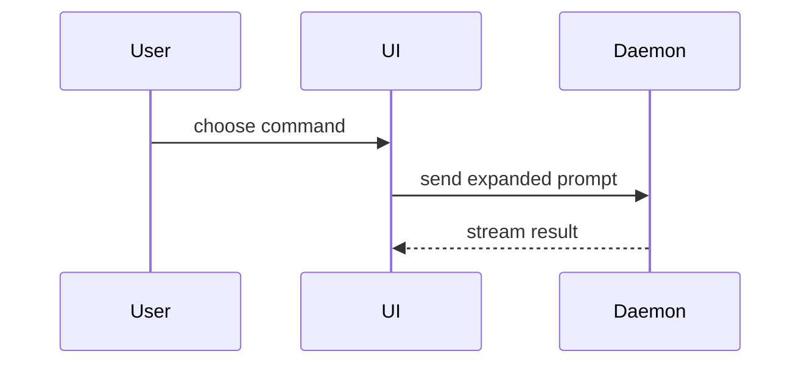

Use this template for writing the PR body:

```markdown
## Summary

<diagram, diff-sketch, or tree>

## Evidence

- **Before:** <screenshot/output/failing test run>
  **After:** <screenshot/output/passing test run>

## Merge Danger

**Door:** <one-way or two-way>

<optional: description>

**Blast Radius:** <one-word description>

<optional: potential ramifications of merge>
```

When the repo has existing PRs, first read [references/repo-pr-conventions.md](references/repo-pr-conventions.md) and match how its accepted PRs read; it also catches the rejection triggers (too big, no tests, scope creep). Skip it only for a new or solo repo with no PR history.

## Sections

Skip all preambles and keep prose brief: brief means high signal density, not dropping the why. Use the user's domain language from `GLOSSARY.md`.

### Summary

Pick the smallest view that makes the key point clear. Prefer **one** view, and emit a visual only if you can ground it in the actual diff: an agent-drawn call tree or Mermaid that misreads the code is worse than prose.

- Show logic or an algorithm as pseudocode:

```text
on(save)
  if content is unchanged
    return cached result
  write new content
  return fresh result
```

- Show runtime control flow as a call tree:

```text
submitForm
  createSession
    persistPrompt
    launchAgent
  navigateToSession
```

- Show UI structure as a component tree, including state and module boundaries that matter:

```text
<SessionPage> (apps/example/src/routes/session.tsx)
  useSessionEvents()
  <SessionToolbar>
    <RunSkillButton> (packages/ui)
```

- Show file responsibility or a broad refactor as a shallow file tree:

```text
src/
├── commands/       # parses user actions
├── sessions/       # owns session state
└── transport/      # sends API requests
```

- Show component interaction, control flow, or data flow with Mermaid:



- Use `diff` when the point is what changes and the surrounding shape already exists. Match the diff shape to the topic.

For a component change:

```diff
 <SessionPage>
   useSessionEvents()
   <SessionToolbar>
+    <RunSkillButton />
   <SessionTimeline>
+    <SkillResultCard />
```

For a file-layout change:

```diff
 src/
 ├── commands/
+│   └── show-me.ts       # expands the slash command
 ├── sessions/
-└── transport.ts
+└── transport/
+    ├── client.ts
+    └── stream.ts
```

For a call-tree or call-stack change:

```diff
 submitForm
   createSession
     persistPrompt
+    expandSkillMention
     launchAgent
-  navigateToSession
+  navigateToSession
+    subscribeToEvents
```

For a state or control-flow change:

```diff
 on(save)
-  write content
+  if content is unchanged
+    return cached result
+  write new content
+  invalidate cache
```

- Show the whole block when most of it is new, when omitted context would hide ownership or order, or when the user needs a copyable target shape:

```ts
function expandSkill(command: string): string {
  const skillName = command.slice(1);
  return `use the ${skillName} skill`;
}
```

#### Guidance

Place each visual next to the short text it supports. Keep only the calls, files, props, states, and boundaries needed to answer the user's current question or the options to resolve the current discussion point.

Prefer a single highest-value view. You may use several where they each answer a distinct question, but a wall of auto-generated diagrams is noise; don't overwhelm, and never emit a visual you can't derive from the diff.

### Evidence

Concrete evidence that the change works. Show a before and after.

**Capture evidence from a real run; never compose it.** A pasted test block that didn't execute, or a described-but-unrun result, is the single most common agent-PR failure: a description claiming changes that aren't there. Run it, paste the real output.

Screenshots are S-tier **when the change is visual and you can actually capture one**; for a game, a short clip or a deterministic replay is the equivalent proof of behaviour over time. Otherwise execution-based evidence is your top tier: test results, console output. Show the exact test that now fails and passes, using the real output.

### Merge Danger

**Surface candidate risks for the human to judge; don't assert a final verdict.** Reversibility and blast radius are easy to misjudge (a schema migration can look reversible when it isn't), so flag what the reviewer should scrutinise rather than ruling it safe.

Describe whether it's a one-way or two-way door. You can walk back through two-way doors, but not one-way doors. A PR that is cheap to roll back is lower risk. Changes that involve destructive actions or hard-to-reverse decisions are one-way doors.

The blast radius is the potential impact or scope of the changes introduced by this PR. Consider all possibilities. Examples are layout shift, breakages for consumers, mobile responsiveness, etc.
